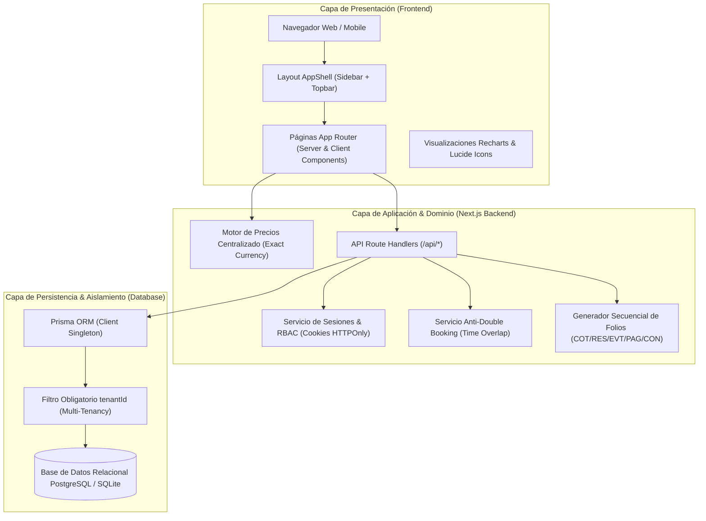
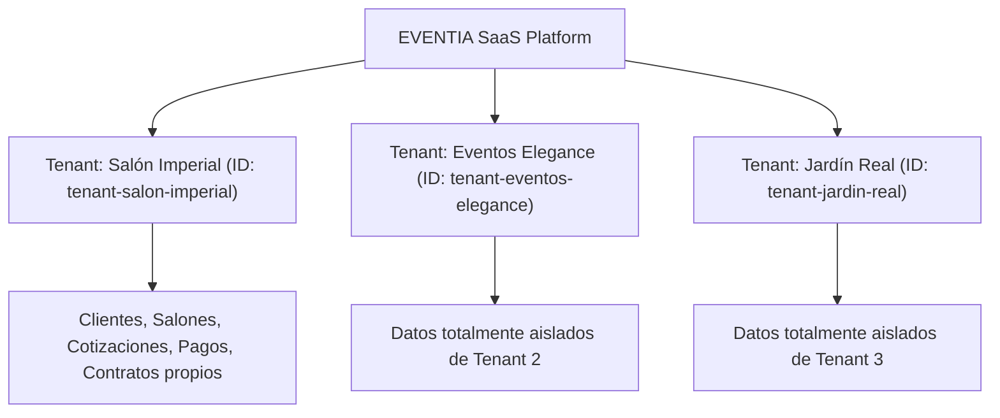

# 05. ARQUITECTURA DEL SISTEMA

## Visión Arquitectónica General
EVENTIA está construido sobre una arquitectura moderna basada en Next.js App Router (React 19 + TypeScript), diseñada con separación estricta de responsabilidades entre la capa de presentación (UI), lógica de dominio financiero (Domain/Pricing Engine), servicios de aplicación (Services/Availability) y capa de persistencia de datos (Prisma ORM con PostgreSQL / SQLite).

---

## Arquitectura SaaS Multi-Tenant
El sistema utiliza el patrón **Shared Database, Shared Schema with Discriminator Column (`tenantId`)**. Este patrón es el estándar de la industria para aplicaciones SaaS eficientes, permitiendo:
1. Despliegue ágil y escalabilidad uniforme.
2. Migraciones centralizadas sin replicar esquemas por cliente.
3. Garantía absoluta de aislamiento mediante validaciones a nivel de middleware y servicio en el backend.

---

## Flujo Operativo y Comercial Continuo
El sistema garantiza que los datos fluyan de manera continua sin recaptura entre módulos:

```mermaid
flowchart LR
    A["Cliente Registrado"] --> B["Nueva Cotización (9 Pasos)"]
    B --> C["Cálculo en Vivo ($52,000)"]
    C --> D["Cotización Guardada (COT-2026-00001)"]
    D --> E["Conversión a Reservación"]
    E --> F["Validación Anti-Double Booking"]
    F --> G["Reservación (RES-2026-00001) + Evento"]
    G --> H["Agenda Visual / Calendario"]
    H --> I["Anticipo Registrado (PAG-2026-00001)"]
    I --> J["Saldo Calculado ($36,400)"]
    J --> K["Contrato Imprimible (CON-2026-00001)"]
```

