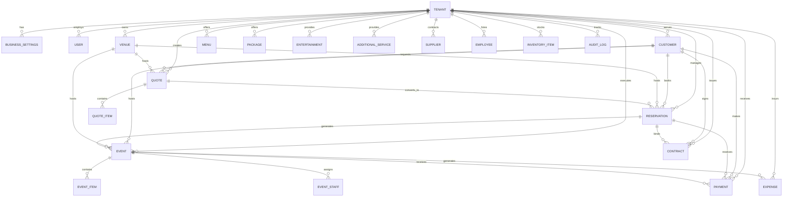

# 06. BASE DE DATOS Y MODELO DE DATOS

## Modelo Entidad-Relación (DER)
El esquema relacional de EVENTIA está completamente normalizado en Prisma ORM, con claves foráneas, índices por tenant y preservación de snapshots inmutables:

---

## Descripción de Entidades Principales

### 1. `Tenant` & `BusinessSettings`
- **Tenant**: Representa cada empresa o salón independiente (`id`, `name`, `slug`, `plan`, `status`).
- **BusinessSettings**: Parámetros operativos y comerciales del salón (`commercialName`, `currency`, `timezone`, `taxRate`, `depositPercentage`, `extraHourPrice`, `policiesText`).

### 2. `User` (RBAC)
- Almacena las credenciales y perfiles de acceso (`email`, `passwordHash` con bcrypt, `name`, `role`).
- `tenantId` es nulo únicamente para el `SUPER_ADMIN` global de la plataforma SaaS.

### 3. `Customer`
- Información de contacto y comerciales del cliente (`name`, `phone`, `whatsapp`, `email`, `address`, `notes`).
- Posee borrado lógico (`deletedAt`) para preservar trazabilidad fiscal.

### 4. `Venue` (Espacios del Salón)
- Espacios físicos administrados (`name`, `capacity`, `basePrice`, `location`, `isActive`).

### 5. `Menu`, `Package`, `Entertainment`, `AdditionalService`
- Catálogos comerciales con precios por persona, tarifas fijas y condiciones de servicio.

### 6. `Quote` & `QuoteItem` (Snapshots Inmutables)
- `Quote`: Folio único (`COT-2026-XXXXX`), cliente, salón, fechas, desglose financiero (`subtotal`, `discountTotal`, `total`) y estado (`DRAFT`, `SENT`, `ACCEPTED`, `CONVERTED`).
- `QuoteItem`: **Snapshot inmutable** que copia textualmente el concepto, precio unitario y cantidad acordados al emitir la cotización. Modificaciones futuras a catálogos no alteran las cotizaciones emitidas.

### 7. `Reservation` & `Event`
- `Reservation`: Folio `RES-2026-XXXXX`, salón, horario, cliente, monto total, anticipos pagados y saldo pendiente en tiempo real.
- `Event`: Folio `EVT-2026-XXXXX`, logística operativa, personal asignado y gastos directos.

### 8. `Payment`
- Transacciones de pago y anticipos con folio `PAG-2026-XXXXX`. Vinculado a la reservación y cliente con método de pago, referencia bancaria y usuario que recibió el abono.

### 9. `Contract`
- Snapshot legal del contrato con folio `CON-2026-XXXXX`, términos acordados, políticas de cancelación y firmas.

### 10. `AuditLog`
- Registro de auditoría de todas las acciones críticas del sistema (`CREATE`, `UPDATE`, `PAYMENT`, etc.) con fecha, usuario y metadata en formato JSON.
