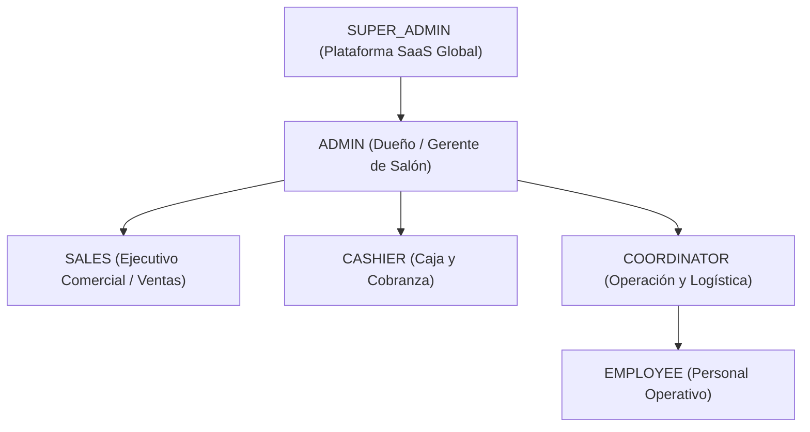

# 08. ROLES Y MATRIZ DE PERMISOS (RBAC)

## Modelo de Roles del Sistema
EVENTIA implementa un modelo de **Control de Acceso Basado en Roles (RBAC)** estricto, evaluado tanto en las vistas como en los endpoints del backend.

---

## Matriz Comparativa de Permisos

| Módulo / Acción | SUPER_ADMIN | ADMIN | SALES | CASHIER | COORDINATOR | EMPLOYEE |
| :--- | :---: | :---: | :---: | :---: | :---: | :---: |
| **Gestión de Empresas (Tenants SaaS)** | ✅ | ❌ | ❌ | ❌ | ❌ | ❌ |
| **Configuración del Negocio (Settings)** | ✅ | ✅ | ❌ | ❌ | ❌ | ❌ |
| **Gestión de Usuarios y Accesos** | ✅ | ✅ | ❌ | ❌ | ❌ | ❌ |
| **Directorio de Clientes** | ✅ | ✅ | ✅ | ❌ | ❌ | ❌ |
| **Catálogos (Salones, Menús, Paquetes)** | ✅ | ✅ | ❌ | ❌ | ❌ | ❌ |
| **Crear y Modificar Cotizaciones** | ✅ | ✅ | ✅ | ❌ | ❌ | ❌ |
| **Aplicar Descuentos Comerciales** | ✅ | ✅ | ✅ | ❌ | ❌ | ❌ |
| **Convertir Cotización en Reservación** | ✅ | ✅ | ✅ | ❌ | ❌ | ❌ |
| **Agenda y Calendario General** | ✅ | ✅ | ✅ | ❌ | ✅ | ❌ |
| **Registrar Pagos y Anticipos** | ✅ | ✅ | ❌ | ✅ | ❌ | ❌ |
| **Emitir Reembolsos** | ✅ | ✅ | ❌ | ✅ | ❌ | ❌ |
| **Emitir Contratos Legales** | ✅ | ✅ | ✅ | ❌ | ❌ | ❌ |
| **Asignación de Personal a Eventos** | ✅ | ✅ | ❌ | ❌ | ✅ | ❌ |
| **Proveedores e Inventario** | ✅ | ✅ | ❌ | ❌ | ✅ | ❌ |
| **Registro de Gastos Operativos** | ✅ | ✅ | ❌ | ✅ | ✅ | ❌ |
| **Reportes Ejecutivos y Métricas** | ✅ | ✅ | ❌ | ❌ | ❌ | ❌ |

---

## Usuarios Demo Preconfigurados en el Seed

| Rol | Correo Demo | Contraseña | Descripción de Acceso |
| :--- | :--- | :--- | :--- |
| **ADMIN** | `admin@salonimperial.demo` | `Admin123!` | Acceso administrativo completo a Salón Imperial |
| **SALES** | `ventas@salonimperial.demo` | `Ventas123!` | Creación de clientes, cotizaciones y conversión a reservas |
| **CASHIER** | `caja@salonimperial.demo` | `Caja123!` | Registro de abonos, cobro de anticipos y arqueo de saldos |
| **COORDINATOR** | `coordinador@salonimperial.demo` | `Coord123!` | Operación de eventos, asignación de personal e inventarios |
| **SUPER_ADMIN** | `superadmin@eventia.demo` | `Super123!` | Acceso global SaaS multi-tenant a todas las empresas |
